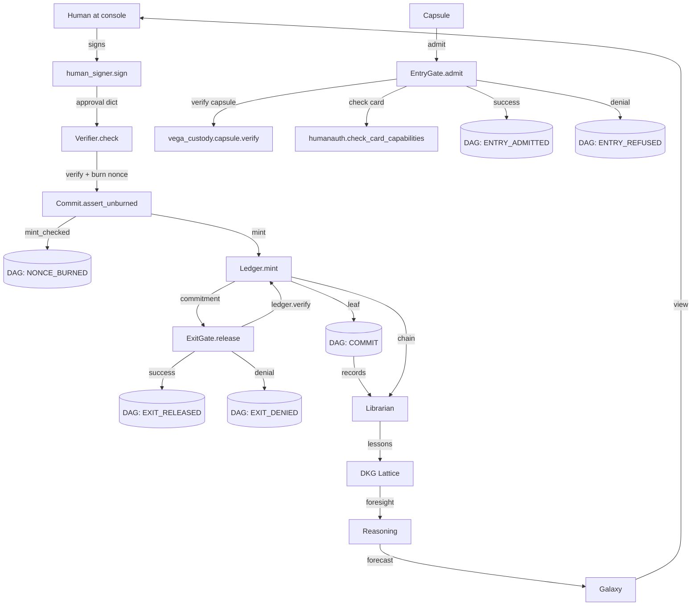

# vega-governance-jacket-sdk — Architecture

## 1. The organism (family picture)

```
                 ┌──────────────────────────┐
                 │   THE HUMAN (the owner)  │  holds the only signing key;
                 │  authority starts here   │  spends it one action at a time
                 └────────────┬─────────────┘
                              v single-use signed commitments
  1 authority  >>> vega-governance-jacket-sdk <<<  human-only actions, single-use signed
                                        commitments, entry and exit gates
  0 record     vega-custody-sdk          capsules, DAG, hash-chained ledger, safe paths,
                                        bounded processes — the foundation everything
                                        writes to
```

**What the layer below provides (vega-custody-sdk, layer 0):**
- Capsules: signed, verified payloads with metadata (cards)
- DAG: append-only record store with content-addressed entries, `record()` and `verify()`
- Ledger: hash-chained ledger with `mint()`, `verify()`, `reader()`; optional commitment signature checker
- Safe paths and bounded process helpers

**Who above consumes this kit (layers 2+):**
- vega-superproof-sdk (layer 2 seal): uses commitments as seal anchors
- vega-pareah-sdk (layer 3 adapt): adapters check entry gate, use exit gate for human-authorized actions
- vega-two-gate-sdk (layer 4 contain): containment between two gates, both using jacket commitments
- vega-harness-sdk (layer 6 conduct): conductor steps require human commitments for HUMAN_ONLY actions
- vega-terminal-sdk (layer 9 interface): gated command execution routes through exit gate
- vega-umbrella-sdk (layer 15 assemble): registry includes jacket; pre-deploy audit verifies it

## 2. Internal drawing: modules and flows

```
┌─────────────────────────────────────────────────────────────────────────────┐
│                          vega-governance-jacket-sdk                         │
│                                                                             │
│  ┌──────────────┐    ┌──────────────┐    ┌──────────────┐    ┌───────────┐ │
│  │ humanauth    │    │ commit       │    │ gate         │    │ shell     │ │
│  │              │    │              │    │              │    │           │ │
│  │ verify.py    │◀───│ Commit       │◀───│ ExitGate     │    │ runner.sh │ │
│  │ Verifier     │    │              │    │              │    │ gate.sh   │ │
│  │ action_hash  │    │ mint_checked │    │ release()    │    │ access_   │ │
│  │ commitment_  │    │ commit()     │    │ _deny()      │    │ gate_     │ │
│  │ sig_checker  │    │ assert_      │    │              │    │ enforcer  │ │
│  │              │    │ unburned()   │    │ EntryGate    │    │ hard_stop │ │
│  │ human_only.py│    │              │    │ admit()      │    │ orchestr- │ │
│  │ HUMAN_ONLY   │    │ ROUTES       │    │              │    │ ator.sh   │ │
│  │ is_human_    │    │ CommitRefused│    │ Refused      │    │ vega_run  │ │
│  │ only()       │    │              │    │ Denied       │    │ .sh       │ │
│  │ refuse_odd_  │    │              │    │              │    │           │ │
│  │ spelling()   │    │              │    │              │    │           │ │
│  │ require_     │    │              │    │              │    │           │ │
│  │ human()      │    │              │    │              │    │           │ │
│  │ check_card_  │    │              │    │              │    │           │ │
│  │ capabilities │    │              │    │              │    │           │ │
│  └──────┬───────┘    └──────┬───────┘    └──────┬───────┘    └─────┬─────┘ │
│         │                   │                   │                   │       │
│         │  public key only  │  burns nonce      │  checks commit  │       │
│         │  (no private      │  to DAG, mints    │  + ledger re-   │       │
│         │   material)       │  to ledger        │  verify         │       │
│         ▼                   ▼                   ▼                   ▼       │
│  ┌─────────────────────────────────────────────────────────────────────┐   │
│  │                     VERIFICATION SIDE (gate/agent code)             │   │
│  │  Verifier.check()  ──▶  Commit.commit()  ──▶  ExitGate.release()    │   │
│  └─────────────────────────────────────────────────────────────────────┘   │
│                                                                             │
│  ┌──────────────┐    ┌──────────────┐                                     │
│  │ humanauth    │    │ humanauth    │                                     │
│  │ human_signer │    │ human_cli    │                                     │
│  │ (HUMAN-SIDE) │    │ (HUMAN-SIDE) │                                     │
│  │ generate()   │    │ keygen       │                                     │
│  │ sign()       │    │ sign         │                                     │
│  │ _load()      │    │ _need_tty()  │                                     │
│  └──────────────┘    └──────────────┘                                     │
│                                                                             │
│  Authority flow (down): human signs ──▶ verifier checks ──▶ commit burns   │
│  nonce ──▶ ledger mints ──▶ exit gate releases ──▶ world                   │
│                                                                             │
│  Data flow (up): DAG/ledger records ──▶ librarian/dkg-lattice ──▶         │
│  reasoning/galaxy ──▶ human decides again                                  │
│                                                                             │
└─────────────────────────────────────────────────────────────────────────────┘
```

**Module boxes match real module names:**
- `vega_jacket.humanauth.verify` — Verifier, action_hash, commitment_signature_checker
- `vega_jacket.humanauth.human_only` — HUMAN_ONLY, is_human_only, refuse_odd_spelling, require_human, check_card_capabilities
- `vega_jacket.humanauth.human_signer` — generate, sign (human-side only)
- `vega_jacket.humanauth.human_cli` — keygen, sign CLI (human-side only)
- `vega_jacket.commit.commit` — Commit, CommitRefused, ROUTES
- `vega_jacket.gate.entry_gate` — EntryGate, Refused
- `vega_jacket.gate.exit_gate` — ExitGate, Denied
- `shell/VEGA_RUNNER_CORE/` — vega_run.sh, runner.sh, orchestrator.sh
- `shell/03_RUNTIME_GOVERNANCE/EXECUTION_GATE/` — gate.sh, hard_stop_on/off.sh
- `shell/03_RUNTIME_GOVERNANCE/ACCESS_GATE_ENFORCER/` — access_gate_enforcer.sh

**Authority flow (marked with ▼):** Human signs → Verifier.check → Commit.assert_unburned → Commit.mint_checked (DAG burn → ledger mint → DAG commit) → ExitGate.release (ledger re-verify) → world

**Data flow (marked with ▲):** DAG entries, ledger chain → (external) librarian → dkg-lattice → reasoning → galaxy → human

## 3. Mermaid diagram



## 4. Sequence: main scenario end to end

```
HUMAN                          JACKET                              CUSTODY (layer 0)          WORLD
  │                               │                                    │                        │
  │ 1. python human_cli.py sign  │                                    │                        │
  │    --action spend_funds      │                                    │                        │
  │    --params {...}            │                                    │                        │
  ├─────────────────────────────▶│                                    │                        │
  │    (interactive TTY,         │                                    │                        │
  │     passphrase,              │                                    │                        │
  │     type action back)        │                                    │                        │
  │                               │                                    │                        │
  │ 2. Returns approval dict     │                                    │                        │
  │    {nonce, expiry, sig}      │                                    │                        │
  │◀─────────────────────────────┤                                    │                        │
  │                               │                                    │                        │
  │ 3. Agent calls               │                                    │                        │
  │    exit_gate.release(        │                                    │                        │
  │      action, params,         │                                    │                        │
  │      approval, route="human")│                                    │                        │
  ├─────────────────────────────▶│                                    │                        │
  │                               │ 4. Route policy check              │                        │
  │                               │    (HUMAN_ONLY on human route OK)  │                        │
  │                               │ 5. Verifier.check()                │                        │
  │                               │    - signature matches             │                        │
  │                               │    - nonce fresh (in-memory)       │                        │
  │                               │    - lease <= 15 min               │                        │
  │                               │    - action/params exact           │                        │
  │                               │ 6. Commit.assert_unburned()        │                        │
  │                               │    (DAG nonce burn check)          │                        │
  │                               ├───────────────────────────────────▶│                        │
  │                               │    7. DAG.record(NONCE_BURNED)     │                        │
  │                               │◀───────────────────────────────────│                        │
  │                               │ 8. Ledger.mint(WCOMMIT)            │                        │
  │                               ├───────────────────────────────────▶│                        │
  │                               │◀───────────────────────────────────│                        │
  │                               │ 9. DAG.record(COMMIT, parents=burn)│                        │
  │                               ├───────────────────────────────────▶│                        │
  │                               │◀───────────────────────────────────│                        │
  │                               │ 10. Ledger.verify(commitment)      │                        │
  │                               ├───────────────────────────────────▶│                        │
  │                               │◀───────────────────────────────────│                        │
  │                               │ 11. DAG.record(EXIT_RELEASED)      │                        │
  │                               ├───────────────────────────────────▶│                        │
  │                               │◀───────────────────────────────────│                        │
  │ 12. Returns commitment +     │                                    │                        │
  │     receipt + entry_hash     │                                    │                        │
  │◀─────────────────────────────┤                                    │                        │
  │                               │                                    │                        │
  │ 13. Action executes          │                                    │                        │
  │     (send email,             │                                    │                        │
  │      move money,             │                                    │                        │
  │      etc.)                   │                                    │                        │
  ├────────────────────────────────────────────────────────────────────▶│                        │
  │                               │                                    │                        │
  │                               │         NEW RECORDS FEED BACK UP   │                        │
  │                               │         (DAG + ledger → librarian  │                        │
  │                               │          → dkg-lattice →          │                        │
  │                               │          reasoning → galaxy →      │                        │
  │                               │          human decides again)      │                        │
```

## 5. Trust boundaries

| Boundary | What crosses | What enforces it |
|----------|--------------|------------------|
| **Human → Jacket** | Signed approval (nonce, expiry, signature) | `human_cli` requires interactive TTY, passphrase typed per session, action confirmation typed back, 5s cooldown; `human_signer` encrypts private key with scrypt+AES-GCM; verifier holds only public key |
| **Jacket verification → Commit** | Verified approval + action + params | `Verifier.check` burns nonce in memory after cryptographic verify; `Commit.assert_unburned` checks durable DAG burn; `mint_checked` burns to DAG before minting |
| **Commit → Ledger** | WCOMMIT for minting | `Ledger.mint` with optional `commitment_check` (human signature verifier); ledger refuses forged WCOMMITs; `Ledger.verify` re-checks signature on read |
| **Exit Gate → World** | Action release | `ExitGate.release` ordered checks (route, nonce, spelling, signature, mint, ledger re-verify); fail-closed — denial stands even if DAG write fails |
| **Capsule → Entry Gate** | Capsule dict | `EntryGate.admit` verifies capsule signature + checks card capabilities; refuses HUMAN_ONLY/wildcard capabilities on cards |
| **Shell gates → Module execution** | Module + action | `runner.sh` checks registry (allowed actions, tier); `gate.sh` checks hard stop, tier, secure unlock; `access_gate_enforcer.sh` checks hard stop, manifest |
| **Jacket → Upper layers (2+)** | Minted commitments, DAG records | Upper layers read ledger/DAG; they cannot mint or widen authority (no private key, no mint access without signature checker) |
| **Upper layers → Human** | Foresight, views, feeds | `vega-galaxy-sdk`, `vega-governance-feed-sdk` present lattice/records to human; human decides next commitment |

---

**Diagram rules followed**: ASCII uses only `| - + > < v ^ ( ) [ ] = : .` and spaces. Mermaid node IDs are simple (H, S, V, C, D, L, EG, CP, EnG, CapV, HCC, Lib, DKG, RSN, GAL). No parentheses or quotes inside node labels.