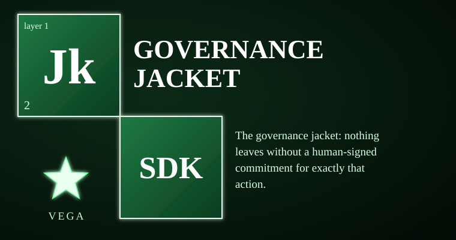

# vega-governance-jacket-sdk



<!-- vega-install-order -->
> **Build order: 2/2. This kit needs 1 other Vega kit installed first.** Install them in this order, then this one:
> 1/2 `vega-custody-sdk`  
> 2/2 `vega-governance-jacket-sdk` (this kit)
> Install each with `pip install --no-deps git+https://github.com/jasonblasiak868-code/<name>` in the order shown, plus `pip install cryptography`. Full steps: [INTEGRATION_GUIDE](https://github.com/jasonblasiak868-code/vega-umbrella-sdk/blob/main/INTEGRATION_GUIDE.md).

The governance jacket: human-only actions, single-use signed commitments, entry and exit gates. It owns the authority concern — nothing crosses the boundary into the world without a human's signature for exactly that action, once, with a short lease. The model may think and draft freely; acting requires a commitment the model cannot mint, widen, or replay.

> **Licensing.** Source-available, not open source. Free for personal use; free for registered small businesses (under US$1M revenue and valuation); everyone else needs a commercial license (see LICENSE; for a commercial license write to jasonblasiak.ai.mail@gmail.com). Patent pending. Draft licence text, not yet reviewed by an attorney.

## Why this exists

When an AI can act — send the email, move the money, change the file — the trouble starts. Training, policies, and self-checks do not stop a model or a steered model from acting outside its bounds. A human reviewer becomes a bottleneck who stops reading and clicks yes.

This kit moves the authority outside the model. A human signs a commitment for one exact action with exact parameters, valid for at most 15 minutes, usable once. The gate checks the signature before anything leaves. The nonce is burned to a durable record so a restart is not a replay window. A gate failure also refuses — it fails closed.

## Capabilities

| Capability | How you can check it |
|------------|---------------------|
| Human-only action list (11 actions) enforced at gate and card level | `humanauth.is_human_only()`, `check_card_capabilities()` — test_humanauth.py, test_commit.py |
| Single-use commitment with durable nonce burn (survives restart) | `Commit.assert_unburned()`, `mint_checked()` — test_commit.py lines 79-80 |
| Entry gate admits only verified capsules; refuses cards claiming human-only power | `EntryGate.admit()` — test_commit.py lines 98-103 |
| Exit gate requires minted, verified commitment for exact action; fail-closed | `ExitGate.release()` — test_commit.py lines 66-72, redteam_2 |
| Human signer runs only in an interactive terminal; passphrase never on disk | `human_cli._need_tty()`, `human_signer.sign()` — redteam_2 lines 93-100 |
| 15-minute lease cap; wildcards and blank actions refused | `Verifier.check()` — redteam_1 lines 89-92, support_humanauth_checks |
| Ledger verifies human signature on every WCOMMIT; forged commitments refused | `commitment_signature_checker()` — redteam_3 J4 tests |
| Route policy: HUMAN_ONLY actions denied on card/model routes | `Commit.commit()`, `ExitGate.release()` — test_commit.py lines 68-69 |
| Odd spellings of HUMAN_ONLY actions refused (Unicode normalization) | `refuse_odd_spelling()`, `human_only.normalize()` — redteam_1 lines 116-122, redteam_3 J1 |

## Where it sits in the family

Layer 1 (authority) — depends on layer 0 (vega-custody-sdk for capsules, DAG, ledger). Consumed by layers 2+ (superproof, pareah, two-gate, harness, terminal, umbrella).

One family, one organism: every SDK owns exactly one concern and uses the owner of every other concern instead of growing its own copy.

```
                 ┌──────────────────────────┐
                 │   THE HUMAN (the owner)  │  holds the only signing key;
                 │  authority starts here   │  spends it one action at a time
                 └────────────┬─────────────┘
                              v single-use signed commitments
  1 authority  >>> vega-governance-jacket-sdk <<<  human-only actions, single-use signed
                                        commitments, entry and exit gates
  0 record     vega-custody-sdk          capsules, DAG, hash-chained ledger, safe paths,
                                        bounded processes — the foundation everything
                                        writes to
```

## Quick start

```bash
# Put src of this repo and vega-custody-sdk on PYTHONPATH
export PYTHONPATH=/path/to/vega-governance-jacket-sdk/src:/path/to/vega-custody-sdk/src:$PYTHONPATH
```

```python
# Minimal import + pure function check
from vega_jacket.humanauth.verify import action_hash, MAX_LEASE_SECONDS
print(action_hash({"to": "ledger", "amount": 1}))  # deterministic SHA-256
print(MAX_LEASE_SECONDS)  # 900 (15 minutes)
```

The human-side signer and CLI live in `vega_jacket.humanauth.human_signer` and `human_cli` — deliberately not re-exported from the package face so agent and gate code have no import path to them.

## What it does NOT do

- Not a security review — no independent cryptographic audit; the code is a reference implementation
- Not an OS sandbox — process containment is not a kernel-level boundary; a side door bypassing the gate voids the guarantee
- Not a legal opinion — the licence matrix is policy, not legal advice; the licence text is a draft not reviewed by an attorney
- Hardware-held keys (TPM, FIDO2) are designed only; the signer uses a software key unlocked by a typed passphrase
- The human is still the weak point — if a person approves carelessly, the gate cannot help
- An agent that can type into the human's terminal defeats the signer's TTY check

## Tests

75 tests in 6 files (STATUS.md). Run:

```bash
python -m tests.test_humanauth
python -m tests.test_commit
python -m tests.redteam_1_signature_and_authority
python -m tests.redteam_2_commit_gate_cli
python -m tests.redteam_3_audit_findings
```

All tests must pass. REVIEW.md records 58 tests passing with one informational finding (exit_gate fail-closed denial recording).

## Status & honesty

Reference implementation, work in progress, not independently security-reviewed, crypto not expert-reviewed. Hardware key support is designed only. This kit details one branch of a broader filed architecture. The remaining branches are the subject of filed disclosures and are outside the scope of this repository. Patent pending (U.S. provisional application 64/178,949 and others).
